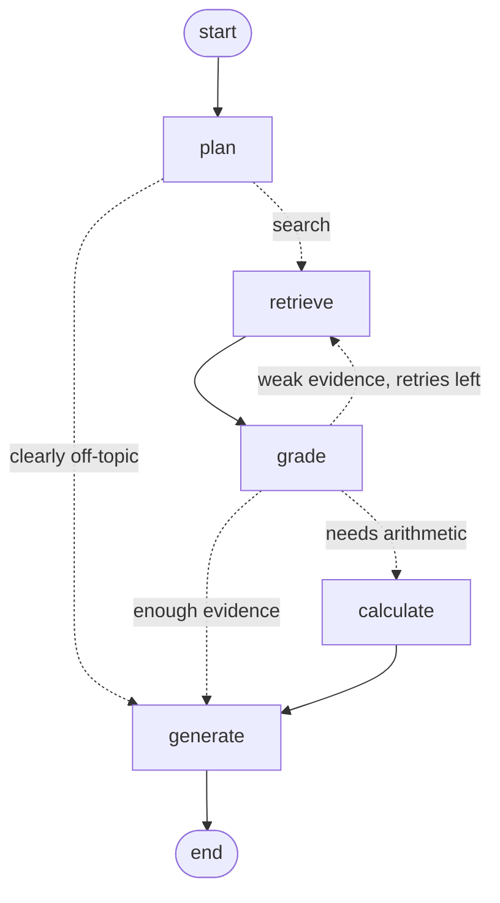

# Agentic Lending Policy RAG

An assistant that answers credit and lending policy questions from RBI Master Directions and
published bank lending policies, **with a citation for every claim**. An agent decides when and
how to retrieve, rewrites vague questions, checks its own evidence before answering, and calls
tools for EMI and FOIR calculations.

The project compares three systems on the same 60-question gold set: plain RAG, a ReAct agent
written by hand in plain Python, and a LangGraph agent.

> **Status:** all three systems scored on the full gold set. Hugging Face demo next.

## Results

All 60 gold questions (30 direct, 10 multi-hop, 10 calculation, 10 unanswerable), each checked
by hand against the source PDF. Same retriever for every system: hybrid search + re-ranker, top 5.
Answers by `gemini-3.5-flash-lite`; graded by a different model (`openai/gpt-oss-120b` on Groq) so
no system grades itself. Per-question results: [`data/eval/results/`](data/eval/results/).

| System | Correct | Citation accuracy | Right page retrieved | Abstained when it should (10) | False refusals | Model calls / question | Tokens / question | Latency p50 |
|---|---|---|---|---|---|---|---|---|
| Plain RAG | 82% | 95% | 94% | 100% | 6% | 1.0 | 2,081 | 3.6 s |
| Hand-written ReAct agent | **90%** | 93% | 92% | 100% | **0%** | 3.2 | 4,528 | 10.1 s |
| LangGraph agent | **91%** | 92% | 92% | 100% | **0%** | 3.3 | 3,284 | 13.2 s |

By question type (correct):

| System | Direct (30) | Multi-hop (10) | Calculation (10) | Unanswerable (10) |
|---|---|---|---|---|
| Plain RAG | 93% | 65% | 45% | 100% |
| ReAct agent | 98% | 90% | 55% | 100% |
| LangGraph agent | 97% | 95% | 60% | 100% |

*Correct* is the judge's score (1, 0.5 or 0 per question) against the verified answer.
*Citation accuracy* is the share of claims the judge found supported by the passage they cite.
*Right page retrieved* means a passage from the gold page was among those the system saw.
With 10 questions per type, one question moves a type's score by 10 points: read small gaps
as noise.

**What the numbers say**

- **Re-searching is what the agent buys.** Multi-hop goes from 65% to 90% and false refusals
  from 3 to 0: plain RAG gives up when one search of 5 passages misses part of the answer
  (g32 needs three banks' policies); the agent searches again.
- **Plain RAG applied the wrong rule once** (g31): it quoted RBI's *microfinance* calling hours
  (9 a.m.–6 p.m.) instead of the general recovery rule (8 a.m.–7 p.m.). Cited and fluent, but
  wrong, the most dangerous kind of error. The agent got it right.
- **Calculation is the weak spot for both, and the calculator barely helped (45% to 55%).**
  In the 10 calculation questions the ReAct agent: stopped without computing 3 times (g47, g49,
  g50, even with an EMI tool available), had no tool for plain arithmetic (15 days × ₹100,
  0.40% of ₹50 crore), picked the wrong LTV slab twice (g41, g44), and used the EMI tool on a
  bullet loan (g42).
- **The two agents score the same within noise (90% vs 91%).** The LangGraph agent uses 27%
  fewer tokens than ReAct (3,284 vs 4,528: its grader passes on only the passages it keeps) but
  is slower (13.2 s vs 10.1 s p50: more, smaller sequential calls). It spent its second search on
  9 questions and routed 3 questions away without searching.
- **Costs:** an agent takes about 3.3× the calls and 3-4× the latency of plain RAG, for +8-9
  points overall, almost all of it on multi-hop questions and false refusals.
- **Root cause of the calculation misses, found in the traces:** on g50 the LangGraph agent
  called the EMI tool twice and the tenure tool once and got the right figures (₹17,995,
  ₹18,643, 268.8 months), then left every figure out of the answer. The answer prompt says
  every claim must cite a numbered source and use only facts stated in the sources; calculator
  results are not numbered sources, so the model obeys the prompt and drops them. The same rule
  explains g47 and g49 (15 days × ₹100 and 0.40% of ₹50 crore never appear). The fix is to give
  calculator results their own source numbers so they can be cited.
- **Remaining misses are partial answers** that drop a condition (g17: the multi-lender
  condition; g35: the six-month deadline).

These failures were found on the gold set, so fixing them and re-scoring on the same questions
would overstate the gain. Fixes (calculator results as citable sources, an arithmetic tool,
slab lookup inside the LTV tool) will be scored on a fresh set of calculation questions and
reported separately.

Why each design choice was made, with the evidence: [`docs/DECISIONS.md`](docs/DECISIONS.md). Rules for AI coding assistants working in this repo: [`AGENTS.md`](AGENTS.md).

## Chunking: section-aware, chosen on a 15-question probe

Three strategies were embedded with BGE-small and scored on 15 questions, each pinned to the page
that answers it ([`data/eval/probe_questions.jsonl`](data/eval/probe_questions.jsonl)). A hit means
a top-k chunk comes from the answer document and covers the answer page.

| Strategy | Chunks | Hit@1 | Hit@3 | Hit@5 | MRR@5 |
|---|---|---|---|---|---|
| Fixed 1,200 chars | 1,384 | 40% | 60% | 67% | 0.51 |
| Recursive (LangChain) | 1,691 | 40% | 60% | 73% | 0.51 |
| **Section-aware** | 1,751 | **47%** | **73%** | **93%** | **0.62** |

Section-aware chunking splits at RBI's own structure (Chapter / lettered section / numbered
paragraph such as `60K.`), never mixes two sections, and prefixes each chunk with its location
("Credit Facilities > Chapter VII - Project Finance > D. Other Provisions"). 59–66% of its RBI
chunks start at a paragraph boundary, against 0% (fixed) and 17% (recursive).

What this does and does not show:

- 15 questions is a directional check (14 vs 11 vs 10 found in the top 5), not a significant
  result. The 60-question gold set re-tests it.
- **Same-sounding banks.** "Will SBI acknowledge my loan application?" fails under every strategy:
  every bank's Fair Practices Code says much the same thing, and the embedding ignores the bank's
  name. The fix is issuer filtering in the agent's query step and hybrid BM25 search (week 3).
- **Rank 1 is weak** (47%): the answer is usually retrieved but not first. That is the
  cross-encoder re-ranker's job (week 3).
- A first run found chunks up to 670 real tokens (number-heavy tables run ~2.5 chars per token),
  which BGE silently truncates at 512. All strategies now re-split by the model's own tokenizer
  (max 500 tokens); the scores did not change.

Reproduce: `python scripts/extract_pages.py`, `python scripts/chunk_corpus.py`,
`python scripts/eval_retrieval.py`.

### Search: hybrid + re-ranker

On the same 15 probe questions and the section-aware index
([`eval_search_modes.py`](scripts/eval_search_modes.py), no LLM calls):

| Search | Hit@1 | Hit@3 | Hit@5 | MRR@5 | p50 latency (CPU) |
|---|---|---|---|---|---|
| Dense (BGE-small) | 47% | 73% | 93% | 0.62 | 41 ms |
| Hybrid (BM25 + dense, RRF) | 53% | 87% | 93% | 0.69 | 50 ms |
| **Hybrid + cross-encoder re-rank** | **67%** | **87%** | **100%** | **0.80** | 1,285 ms |

BM25 catches exact wording that embeddings blur; the cross-encoder (`ms-marco-MiniLM-L-6-v2`)
re-scores the top 20 by reading question and passage together. The SBI question that dense search
never found now comes back at rank 4. The price is ~1.3 s per search on a laptop CPU, which
matters for agents that search several times per question. Re-rank is the default for all systems.

## Agents

Two agents wrap the same retriever, calculators and cited-answer format, so the gold set scores
all three systems the same way.

**Hand-written ReAct loop** ([`react_agent.py`](src/policy_rag/react_agent.py), plain Python):
each step the model writes a thought and picks one action (search, a calculator, or finish);
the result is appended to its history. Capped at 5 steps and 30k tokens.

**LangGraph agent** ([`graph_agent.py`](src/policy_rag/graph_agent.py)): the control flow is fixed
in the graph and the model answers only small, checkable questions.



- **plan**: routes the question; writes 1-3 searches in regulatory wording (splits two-part
  questions, expands "SBI" to "State Bank of India"); flags arithmetic.
- **grade**: keeps only relevant passages; if they do not answer the question, writes one better
  query and retrieves again (corrective RAG), at most 2 rounds and 30k tokens.
- **calculate**: the model picks calculator calls; Python runs them (EMI, tenure, FOIR, LTV).
- **generate**: the same cited-claims answer as plain RAG, over graded evidence only.

First live runs of the ReAct agent: "max home loan on a Rs 40 lakh flat" went search, then
`max_loan_for_ltv(4000000, 80)`, giving Rs 32 lakh, cited (4 calls). "Will SBI acknowledge my loan
application?", missed by every chunking strategy, worked after the agent rewrote "SBI" to "State
Bank of India" in a second search.

## Demo

```bash
pip install -e ".[agent,app]"
streamlit run app.py
```

Pick plain RAG, the ReAct agent or the LangGraph agent, ask a question, and get the cited answer,
the cited passages (with page numbers, repealed sources flagged), the passages retrieved but not
cited, and each step the agent took. Questions go through the same guardrails as the eval.

Because it runs on a free Gemini key, the demo caps model calls: `DEMO_SESSION_QUESTIONS`
(default 10 per visitor) and `DEMO_DAILY_CALLS` (default 300, under the 500/day free limit).
Cache hits cost nothing, so the example questions are free once answered.

Deploying it as a Hugging Face Space (Docker; HF retired its built-in Streamlit SDK):
`python scripts/build_space.py --push --space <user>/lending-policy-assistant`. The script ships
the app, the runtime modules, only the `policy_chunks` index and the response cache; the Gemini
key goes in as a Space secret, never into a file. The Space shares the owner's Gemini quota, so it
is capped at 200 model calls a day.

Known limitation (fixed after the scored runs, see `docs/DECISIONS.md` #12): the LangGraph planner only routes clearly off-topic questions away, so a
question about live data ("What is RBI's repo rate today?") is searched twice before the agent
abstains (4 calls, ~24 s instead of 1). The abstention is correct; it is just costly. Teaching the
planner to spot live-data questions would fix it, but the gold set has questions of exactly that
kind, so the change is held back until after the scored runs to avoid tuning on the test set.

## Guardrails

Every system runs behind the same wrapper ([`guardrails.py`](src/policy_rag/guardrails.py)), and
the gold-set scores are measured with it on.

- **Input:** personal identifiers (PAN, Aadhaar, card and account numbers, phone, email) are
  redacted before any API call or trace; empty, over-long and prompt-injection questions
  ("ignore previous instructions", "reveal your system prompt") are refused.
- **Output:** every claim must cite a retrieved source; uncited claims are dropped, and an answer
  with nothing cited left becomes "I can't answer that from the documents".

## Observability

Opt-in LangSmith tracing ([`tracing.py`](src/policy_rag/tracing.py)): set `LANGSMITH_TRACING=true`
in `.env`. Each question becomes one trace: guardrail, agent steps or LangGraph nodes, every
search with its passages, and every Gemini call with tokens and latency. Traces carry the
redacted question, never the raw one.

## Stack

Runs on an 8 GB laptop at zero cost.

| Layer | Choice |
|---|---|
| Ingestion | `pypdf` (pdfplumber fallback for fragmented PDFs), page numbers kept for citations; section-aware chunking |
| Embeddings | BGE-small (`BAAI/bge-small-en-v1.5`, CPU) vs Gemini embeddings |
| Vector store | Qdrant, local mode (no server) |
| Generation | Gemini (free tier), structured answers with citations |
| Agent | Hand-written ReAct loop, then LangGraph: router, query rewriter, retrieval grader, EMI/FOIR tools |
| Evals | RAGAS + 60-question gold set |
| Observability | LangSmith (opt-in), per-call tokens and latency |
| Demo | Streamlit on Hugging Face Spaces |

### Working inside the free tier

Gemini's free-tier quotas are per project, change without notice, and are shown in AI Studio.
Every LLM call goes through `src/policy_rag/llm.py`, which:

- caches each response on disk, so re-running an eval only pays for what changed;
- throttles to `LLM_MAX_RPM` to stay under the per-minute limit;
- backs off on 429/5xx and stops cleanly when the daily quota is gone.

## Setup

Python 3.11–3.13.

```bash
git clone https://github.com/rc-mathew/agentic-lending-policy-rag
cd agentic-lending-policy-rag
python -m venv .venv
# Windows: .venv\Scripts\activate    macOS/Linux: source .venv/bin/activate

# CPU-only PyTorch first (avoids a ~2 GB CUDA download on Windows/Linux)
pip install torch --index-url https://download.pytorch.org/whl/cpu
pip install -e ".[dev]"

cp .env.example .env   # then add GEMINI_API_KEY
python scripts/check_setup.py
```

## Data

See [`data/README.md`](data/README.md). PDFs are not committed; `data/sources.csv` lists
every document with its source URL and status (current or repealed).

## Layout

```
src/policy_rag/   config, llm, ingest, chunking, retrieve, rag, tools, react_agent, graph_agent,
                  guardrails, tracing, evaluate
scripts/          check_setup, download_corpus, extract_pages, chunk_corpus, eval_retrieval,
                  build_index, ask, agent, graph_agent, evaluate
data/             manifest, corpus notes, eval sets and results (PDFs and processed files git-ignored)
tests/            offline tests (no API calls)
```

## License

MIT
